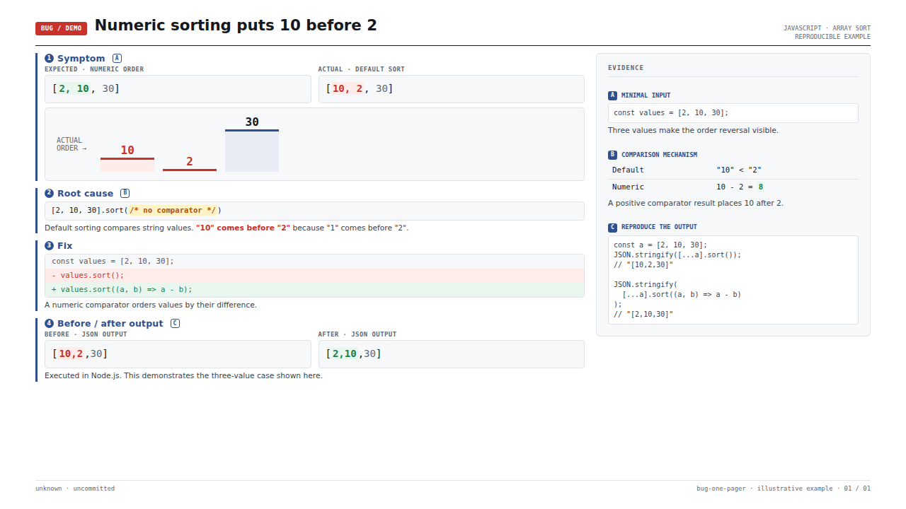

# Skills

Personal collection of agent skills. Each skill lives in its own directory under `skills/`, with a `SKILL.md` entry point and any supporting files kept beside it.

## Available skills

| Skill | Purpose |
| --- | --- |
| [bug-one-pager](skills/bug-one-pager/SKILL.md) | Create self-contained HTML previews for bug reports and comparison decks. |

To use a skill with Codex, copy or symlink its complete directory into `~/.codex/skills/`. Add future skills as separate `skills/<name>/` directories.

## Example: bug-one-pager

A reproducible JavaScript numeric-sorting example: symptom, root cause, a one-line fix, and the observed output.

[View the self-contained HTML source](docs/examples/numeric-sort.html) — download and open it in a browser to preview the slide.
